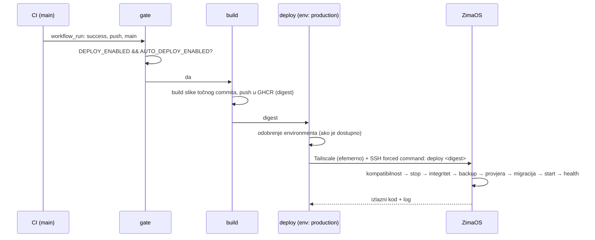

# CI/CD arhitektura

## CI (`.github/workflows/ci.yml`) — na svaki PR, push na `main` i ručno

| Job | Koraci |
|---|---|
| **Provjere** | `npm ci` → TypeScript → ESLint (0 upozorenja) → unit testovi → testovi baze → provjera migracija (destruktivne naredbe, imena, lock) → `prisma migrate diff --exit-code` (shema = migracije) → production build → `npm audit` (produkcijske ovisnosti, high+) |
| **Docker image i smoke test** | build slike (bez objave) → `migrate deploy` na privremenom volumenu → procjena migracija → backup → pokretanje → `/api/health` |
| **Uvoz na Windowsu (NTFS junction)** | testovi uvoza na `windows-2025` (stvarni NTFS junctioni, TOCTOU, BOM) |
| **PR pravila** (`pr-policy.yml`) | PR mora referencirati issue (`Closes #n` / `Refs #n`) i fazu (`Faza: n`); iznimka su Dependabot PR-ovi |

Svaki neuspjeli korak ruši workflow. Testovi nemaju pristup produkciji: nema tajni, nema Tailscalea, baze su privremene.

Sigurnost workflowa: `permissions: contents: read` (minimum), checkout bez spremanja vjerodajnica, sve akcije pinirane na commit SHA (uz oznaku verzije u komentaru), Dependabot ažurira npm, Actions i Docker bazu.

## CD (`.github/workflows/deploy.yml`) — neaktivno dok vlasnik ne uključi

- Okidači: `workflow_run` (samo uspješan CI pokrenut **pushom** na `main` u ovom repozitoriju — PR-ovi i forkovi nikad ne deployaju) i ručni `workflow_dispatch` (`deploy` ili `rollback`, potvrda `PRODUKCIJA`).
- `concurrency: production-deploy` bez prekidanja: dva deploya nikad ne rade istodobno; i `deploy.sh` drži `flock`.
- Slika je označena `sha-<commit>` i `build-<n>`, a deploy koristi isključivo digest.

## Aktivacija (redoslijed)

1. Postavljanje servera prema [ZimaOS deploymentu](zimaos-deployment.md).
2. Tajne i varijable prema [tajnama i konfiguraciji](tajne-i-konfiguracija.md).
3. `DEPLOY_ENABLED=true` → ručni pilot deploy uz odobrenje vlasnika.
4. Nakon završnih testova aplikacije i uspješnog pilota: `AUTO_DEPLOY_ENABLED=true`.

## Ograničenja GitHub plana

Na privatnom repozitoriju s besplatnim planom zaštita grane / rulesets i *required reviewers* za environment nisu dostupni (traže GitHub Pro). U tom slučaju zamjenski mehanizmi su: prekidači `DEPLOY_ENABLED`/`AUTO_DEPLOY_ENABLED`, ručna potvrda `PRODUKCIJA`, deploy samo s `main` i dogovor da se na `main` ne pusha izravno. Stvarno stanje provjereno je nakon kreiranja repozitorija (vidi izvještaj Faze 0).
