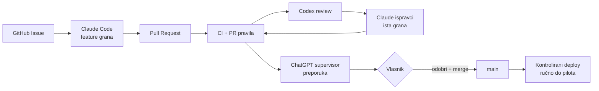

# Multi-agent workflow (pripremljeno, NIJE aktivirano)

Pravila uloga i kriteriji reviewa: [`AGENTS.md`](../../AGENTS.md), [`CLAUDE.md`](../../CLAUDE.md).

## Povezivanje alata

### Claude Code (Lead Developer)

- **Već radi** lokalno na računalu vlasnika preko `gh` CLI-ja (prijava `fluxara-del`): grane, commitovi, PR-ovi. Ne treba dodatna integracija.
- Opcionalno: *Claude GitHub App* + `anthropics/claude-code-action` (odgovara na `@claude` u PR-ovima/issueima, može pushati commitove). **Ne preporučujem za sada:** komentar u PR-u bi mogao pokrenuti izmjene koda i trošiti API, a traži tajnu `ANTHROPIC_API_KEY` u repozitoriju. Ako se kasnije uključi: samo na `issue_comment` od vlasnika, bez `contents: write` na `main`, i nikad s pravom spajanja.

### Codex Code Review (Independent Reviewer)

Postavlja vlasnik u svojem ChatGPT/Codex računu (ne može se aktivirati iz ovog repozitorija):
1. ChatGPT → Codex → postavke → povezati GitHub (instalirati *ChatGPT Codex Connector* GitHub App) **samo za repozitorij `campaign-companion`**.
2. U Codex postavkama za code review uključiti review za taj repozitorij; ručni okidač je komentar `@codex review` na PR-u, a automatski review novih PR-ova je zaseban prekidač (ako ga plan nudi).
3. Codex review **ne smije** imati zadatak da pusha na PR granu. Ako Codex predloži ispravak, primjenjuje ga Claude na svojoj grani.
4. Dostupnost automatskog reviewa i opseg prava GitHub Appa provjeriti pri instalaciji (ovisi o ChatGPT planu).

Napomena: `AGENTS.md` u korijenu repozitorija Codex čita kao upute za review.

### ChatGPT (Technical Supervisor)

Radi izvan GitHuba: vlasnik mu daje link/diff PR-a, Codex komentare i Claudeov izvještaj; preporuku (prihvati/odbij + razlozi) vlasnik ili Claude zapisuje u PR. Nema prava pisanja u repozitorij.

## Zaštita od paralelnog uređivanja

- Jedan Issue = jedna grana = jedan PR = jedan agent koji piše (Claude). Reviewer samo komentira.
- Tijekom reviewa nema force-pusha; ispravci su novi commitovi.
- Novi zadatak koji dira iste datoteke čeka merge prethodnog PR-a.

## Zaštita `main` i spajanje

Ciljna pravila (ruleset ili branch protection na `main`):
- PR obavezan, izravni push zabranjen, force-push i brisanje zabranjeni;
- obavezne provjere: `Provjere (typecheck, lint, testovi, migracije, build, audit)`, `Docker image i smoke test`, `PR pravila (Issue i faza)`; grana mora biti ažurna;
- sve konverzacije razriješene;
- **auto-merge isključen** u postavkama repozitorija; nijedan bot/app nema bypass.

Ograničenja koja treba odlučiti (vidi izvještaj Faze 0):
- Na besplatnom planu privatni repozitorij nema branch protection/rulesets → potreban GitHub Pro, javni repozitorij (ne preporučujem) ili disciplina bez tehničke zaštite.
- PR-ove otvara vlasnikov račun (Claude radi kroz `gh` vlasnika), pa GitHub ne dopušta vlasniku da „odobri” vlastiti PR. Odobrenje vlasnika je zato sam čin spajanja (merge radi isključivo vlasnik), a ne obavezni *approving review*. Alternativa je zaseban bot račun za Claudea, uz dodatno upravljanje pristupom.
