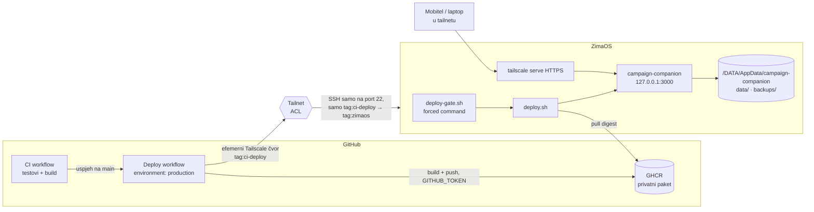

# Deployment na ZimaOS (pripremljeno, NIJE aktivirano)

Ovaj dokument opisuje odabranu arhitekturu i jednokratno postavljanje servera. Ništa od ovoga nije izvršeno na ZimaOS-u u Fazi 0; workflow `Deploy (ZimaOS)` preskače sve korake dok vlasnik ne postavi `DEPLOY_ENABLED=true`.

## Arhitektura



### Zašto ovako

| Zahtjev | Rješenje |
|---|---|
| Bez javnih portova | Aplikacija sluša na `127.0.0.1:3000`; pristup ide kroz `tailscale serve` (HTTPS samo unutar tailneta). **Tailscale Funnel se ne uključuje.** Router nema port forwarding. |
| GitHub Actions bez javnog SSH-a | Workflow se spaja u tailnet kao efemerni čvor (OAuth klijent, `tag:ci-deploy`) i nestaje nakon joba. ACL dopušta samo `tag:ci-deploy → tag:zimaos:22`. |
| Bez privilegiranog self-hosted runnera | Nema runnera na serveru. Runner na GitHubu poziva jednu ograničenu skriptu. |
| Minimalna ovlast na serveru | Zaseban korisnik `kdz-deploy`, ključ u `authorized_keys` s `command="…/deploy-gate.sh",restrict` (bez shella, port-forwardinga i PTY-ja). Gate prihvaća samo `deploy|rollback <ghcr…@sha256:…>` i `status`. |
| Verzionirana slika | GHCR, privatni paket uz repozitorij. Oznake `sha-<commit>` i `build-<n>`; deploy uvijek koristi **digest**, nikad promjenjivi tag. |
| Sačuvani podaci | Baza i kopije su bind mount na `/DATA/AppData/campaign-companion/{data,backups}`, izvan imagea i Gita. Kontejner je `read_only`. |
| Sigurne migracije | `deploy.sh`: procjena kompatibilnosti → zaustavljanje → `integrity_check` → backup (Online Backup API) → provjera kopije → `prisma migrate deploy` → health check. Detalji: [SQLite sigurnost](sqlite-sigurnost.md). |
| Rollback | Automatski samo na prethodnu sliku koja je kompatibilna s bazom; inače se staje i čuva stanje. Detalji: [rollback i restore](rollback-i-restore.md). |
| Izvještaj | Izlazni kod skripte prenosi se kroz SSH u job; uspjeh/neuspjeh vidljiv je u GitHub Actions i u `state/deploy.log` na serveru. |

### Razmotrene alternative

- **Tailscale SSH umjesto OpenSSH-a:** jednostavnije ključeve, ali ne podržava forced command; ACL bi dao puni shell korisniku. Odbačeno za deploy, prihvatljivo za administratora.
- **Pull agent na ZimaOS-u (npr. Watchtower):** ne treba ulazni pristup, ali automatski povlači `latest` bez backup/migracijskih koraka i bez izvještaja natrag u Actions. Odbačeno.
- **Self-hosted runner na ZimaOS-u:** traži zasebnu sigurnosnu procjenu (runner izvršava kod iz workflowa s pristupom Dockeru = root). Odbačeno prema briefu.
- **Docker Hub / vlastiti registry:** GHCR je privatan uz repozitorij i koristi `GITHUB_TOKEN` za push; ne treba dodatni servis.

## Jednokratno postavljanje (radi vlasnik, nakon odobrenja)

1. **Tailscale na ZimaOS-u** (App Store ili službeni paket), prijava u tailnet, oznaka čvora `tag:zimaos`. Uključiti MagicDNS i HTTPS certifikate u Tailscale adminu.
2. **ACL politika** (primjer, prilagoditi tailnetu):
   ```json
   {
     "tagOwners": { "tag:zimaos": ["autogroup:admin"], "tag:ci-deploy": ["autogroup:admin"] },
     "grants": [
       { "src": ["autogroup:member"], "dst": ["tag:zimaos"], "ip": ["443"] },
       { "src": ["tag:ci-deploy"], "dst": ["tag:zimaos"], "ip": ["tcp:22"] }
     ]
   }
   ```
3. **OAuth klijent** u Tailscale adminu s opsegom `auth_keys` (writable) ograničenim na `tag:ci-deploy` → GitHub secrets `TS_OAUTH_CLIENT_ID`, `TS_OAUTH_SECRET`.
4. **OpenSSH** na ZimaOS-u: sluša samo na Tailscale sučelju (`ListenAddress <100.x.y.z>`), `PasswordAuthentication no`. Ne otvara se na LAN-u ni internetu.
5. **Korisnik i direktoriji:**
   ```bash
   sudo useradd -m -s /bin/bash kdz-deploy && sudo usermod -aG docker kdz-deploy
   sudo mkdir -p /DATA/AppData/campaign-companion/{bin,config,data,backups,state}
   sudo chown 1000:1000 /DATA/AppData/campaign-companion/{data,backups}
   sudo chown kdz-deploy /DATA/AppData/campaign-companion/state
   sudo install -m 755 deploy/zimaos/deploy.sh deploy/zimaos/deploy-gate.sh /DATA/AppData/campaign-companion/bin/
   sudo install -m 644 deploy/zimaos/compose.yaml /DATA/AppData/campaign-companion/bin/
   sudo install -m 600 -o kdz-deploy deploy/zimaos/app.env.example /DATA/AppData/campaign-companion/config/app.env
   ```
   Napomena: članstvo u grupi `docker` je efektivno root pristup; zato ključ ima forced command i `restrict`.
6. **Deploy ključ** (ed25519, samo za ovu namjenu): javni dio u `~kdz-deploy/.ssh/authorized_keys` kao
   `command="/DATA/AppData/campaign-companion/bin/deploy-gate.sh",restrict ssh-ed25519 AAAA… kdz-deploy`;
   privatni dio → `DEPLOY_SSH_PRIVATE_KEY`; `ssh-keyscan <host>` preko tailneta → `DEPLOY_SSH_KNOWN_HOSTS` (provjeriti otisak ručno).
7. **Pristup GHCR-u na serveru:** fine-grained ili classic PAT samo s `read:packages`, `docker login ghcr.io` kao `kdz-deploy`. Token ostaje na serveru.
8. **HTTPS u tailnetu:** `tailscale serve --bg --https=443 http://127.0.0.1:3000`. Provjeriti da je Funnel isključen (`tailscale funnel status`).
9. **GitHub:** environment `production` (vidi [tajne i konfiguracija](tajne-i-konfiguracija.md)), varijable `DEPLOY_HOST`, `DEPLOY_USER`, zatim `DEPLOY_ENABLED=true`.
10. **Prvi deploy (pilot):** ručno, *Actions → Deploy (ZimaOS) → Run workflow*, `action=deploy`, `confirm=PRODUKCIJA`. Tek nakon uspješnog pilota i završnih testova aplikacije: `AUTO_DEPLOY_ENABLED=true`.

## Pretpostavke koje treba provjeriti na stvarnom ZimaOS-u

- Dostupnost `bash`, `flock`, `curl` i `docker compose` (v2 plugin) na hostu.
- Je li OpenSSH moguće vezati samo na Tailscale adresu na korištenoj verziji ZimaOS-a, ili Tailscale radi kao kontejner s `network_mode: host`.
- Arhitektura CPU-a (pretpostavljeno `linux/amd64`; za ARM treba dodati platformu u build).
- `/DATA` je lokalni disk (ne SMB/NFS) — SQLite WAL ne smije biti na mrežnom dijeljenju.
