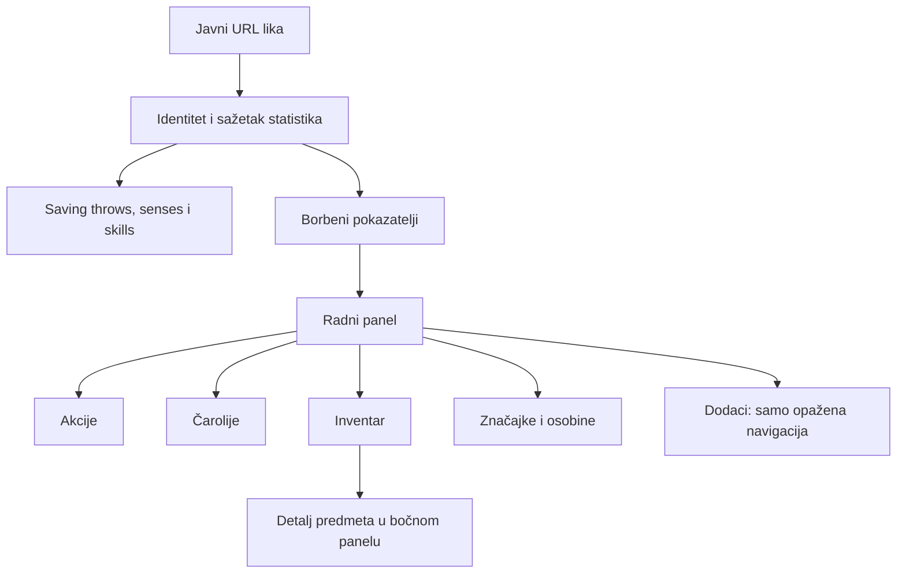
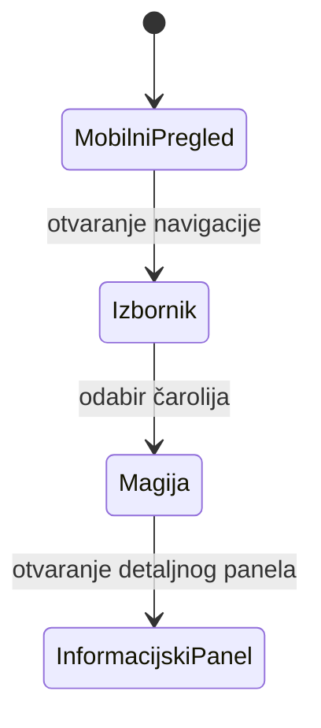

# Analiza javnog digitalnog character sheeta

Referenca: [D&D Beyond character 11128245](https://www.dndbeyond.com/characters/11128245). Istraživanje 23.–24. studenoga 2026.; završna revizija 24. studenoga. Namjena: obrasci funkcionalnosti i interakcije za originalni Campaign Companion, bez reprodukcije proizvoda.

## 1. Metoda i razine dokaza

Korišten je REA MCP `capture_browser_scenario`: Chrome u headless načinu s novim privremenim profilom i praznim početnim storageom. REA prijavljuje Chromium 158.0.8127.36. Uspoređene su širine **1280 × 720** i **390 × 844 CSS px**, device scale factor 1, en-US, UTC emulacija, light mode, reduced motion i blokirani service workeri. UTC je postavka preglednika; datumi izvještaja su lokalni Europe/Warsaw.

Alat je izvršavao deklarirane klikove i čekanja; ovo nije pasivna analiza prethodnih korisnikovih radnji. Očitani su accessibility prikaz, URL i odabrane viewport snimke. Nisu zatraženi DOM/JavaScript izvori, mrežni događaji ili tijela, headeri, cookies, storage, session tokeni niti API zahtjevi. Odbijeni su neobvezni cookies preko javnog gumba. Nije bilo prijave, CAPTCHA rješavanja, zaobilaženja prava pristupa ili promjene character podataka. Preglednik sam učitava resurse stranice; to nije tvrdnja da stranica nije koristila mrežu ili nužne cookies.

Oznake u nastavku:

- **V — verificirano:** neposredno opaženo u navedenom REA koraku. Accessibility sadržaj može uključivati elemente izvan snimljenog viewporta; ne znači da su svi istodobno na ekranu.
- **I — interpretacija:** zaključak o koristi ili mogućem problemu na temelju opažanja; nije test korisnika ni dokaz implementacije.
- **N — neprovjereno:** nije izvršeno ili dokaz ne omogućuje zaključak.
- **P — prijedlog:** originalna odluka za Kronike Devet Zvona.

Oznake R01–R09 povezuju nalaze s punim REA ID-jevima u [registru dokaza](evidence/README.md) i [metapodacima](evidence/rea-metadata.json). `complete` u REA rezultatu odnosi se samo na zatražene artefakte i korake, ne na cjelovitu aplikaciju, pravilnost pravila ili trajno spremanje. Uspješni launch scenariji prijavili su `terminated-owned-process`.

## 2. Struktura i navigacija

**V, R02/overview:** desktop prikazuje identitet i razinu lika iznad niza šest atributa, proficiency bonusa, brzine, inspiracije i HP-a. Ispod se raspored dijeli na blokove saving throws/senses/training, skills te borbene pokazatelje i glavni radni panel. U panelu su sekcije akcija, čarolija, inventara, značajki/osobina i dodataka. Accessibility ih izlaže kao radio kontrole, s označenom aktivnom opcijom.

**V, R02/spells, inventory, features:** klikovi izmjenjuju aktivnu opciju i sadržaj panela, dok URL lika ostaje isti. Gornje statistike ostaju u accessibility prikazu. Opažen je lokalni prijelaz prikaza, ne navigacija na drugi character URL. Sekcija dodataka prisutna je, ali nije otvorena. Bilješke i opis lika nisu zasebne sekcije u ovom anonimnom prikazu; iz toga se ne zaključuje da ne postoje drugdje.

**I:** razdvajanje trajno vidljivog sažetka i promjenjivog panela smanjuje potrebu za traženjem HP-a ili AC-a pri promjeni zadatka. Gustoća desktopa otežava čitanje sitnih oznaka; ovo je stručna procjena, bez mjerenja pogrešaka korisnika.

Snimka S01: R02, korak `overview`, 1280 × 720. Početni dio sheeta; donji sadržaj nije obuhvaćen.

Dijagram prikazuje opaženu informacijsku strukturu; nije interna arhitektura D&D Beyonda.

## 3. Statistike i uređivanje

**V, R01–R03:** atributi prikazuju osnovni broj i modifikator odvojeno. Saving throws i skills prikazuju bonuse i oznake proficiency. Skills imaju stupce za proficiency, vezani atribut, naziv i bonus. Senses prikazuju pasivne vrijednosti i poseban osjet. AC, inicijativa, brzina, obrane i uvjeti zasebne su skupine. U javnom uzorku prisutne su i kontrole za upravljanje nekim skupinama.

**N:** nisu testirani promjena atributa, overrideovi, preračun izvedenih vrijednosti, level-up ni prava vlasnika. Iz međusobno usklađenih prikazanih brojeva nije moguće dokazati algoritam izračuna. Referentni lik nije validacijski fixture za Companion.

**P:** odvojiti osnovnu, izvedenu i ručno nadjačanu vrijednost; uz broj pokazati njegove izvore. Uređivanje treba imati razlog, prije/poslije i potvrdu upisa. Nepoznat podatak mora ostati označen kao nepoznat, osobito pri uvozu postojeće kampanje.

## 4. HP i borbene akcije

**V, R02/overview i R09/hp-settled:** vidljivi su current/max/temp HP, numeričko polje iznosa te dvije odvojene radnje za liječenje i štetu. Prikazan je HP 13/13 i temp prikaz `--`, dok accessible naziv navodi 0. Gumbi za liječenje i štetu u snimljenom početnom stanju označeni su disabled. **Nije utvrđeno je li uzrok prazan iznos, pravo pristupa ili drugi uvjet.**

**V, R09:** klik na trenutni HP završen je bez greške alata; nakon 700 ms dostupni prikaz HP-a ostao je isti i nije zabilježen otvoreni editor. To je ograničeno opažanje, ne dokaz da je HP općenito nepromjenjiv. Iznos nije unošen i nije izvršena šteta ili liječenje.

**V, R02/overview:** akcije imaju skupine prema vrsti radnje i filter ograničenih uporaba. Popis izlaže domet, hit/DC, štetu i napomene. **V, R07/bonus-settled:** odabir filtra bonus akcija zamjenjuje puni popis sadržajem te skupine. URL ostaje isti.

**N:** bacanje kockica, potvrđivanje pogotka, trošenje reakcije, promjena HP-a, death saves i borbena ekonomija nisu izvršeni. Sam prikaz akcije ne dokazuje da aplikacija upravlja cijelim potezom.

**P:** u Companionu razlikovati izbor akcije, zahtjev za bacanje, prijavljeni rezultat i potvrđenu posljedicu. HP promjena mora biti povezana s događajem, izvorom i verzijom. Trenutni projekt zadano koristi igračeva ručna bacanja; AI ne smije izmišljati rezultate.

## 5. Inventory

**V, R02/inventory:** prikaz uključuje ukupnu masu/status opterećenja, valutu, pretraživanje, skupine opreme i spremnika te attunement. Retci sadrže aktivnost, naziv, masu, količinu, cijenu i napomene. Opažene su označene i neoznačene kontrole aktivacije.

**V, R08/backpack-settled:** odabir ruksaka sužava prikaz na taj spremnik i pokazuje prazno stanje. Prazna poruka ovdje se odnosi na odabranu skupinu; ostala oprema postoji u punom prikazu. **V, R08/all-items i bedroll-settled:** povratak na sve predmete vraća popis; odabir retka jednog predmeta otvara informacijski sidebar. U panelu su naziv, izvor, masa, cijena i količina s kontrolama povećanja/smanjenja. Otvaranje retka također je pomaknulo viewport do dostupnog elementa tijekom automatizacije; to nije zaseban test sticky ponašanja.

**N:** promjene količine, novca, equipped/attuned stanja, prijenos među spremnicima, ukupna masa nakon izmjene i spremanje nisu isprobani. Kontrole nisu aktivirane.

**P:** imati stabilan ID instance predmeta, količinu i odvojena polja vlasnik/držatelj/lokacija. Osobni novac i namjenski grupni fond ne smiju se spajati. Potrošnja predmeta i njegova posljedica trebaju jedan atomarni zapis. Otvaranje detalja ne smije samo po sebi potrošiti predmet.

## 6. Spells

**V, R02/spells:** prikaz čarolija uključuje više spellcasting modifikatora, spell attack i save DC za različite izvore lika. Dostupno je pretraživanje s naznakom naziva, vremena bacanja, vrste štete, uvjeta i oznaka. Postoje filtri razina, skupine po razini, slot checkboxovi i kontrole cast/use. U popisu su vrijeme, domet, hit/DC, učinak i napomene; izvori uključuju klasu, osobinu i predmet. Opažene su oznake Legacy, pa uzorak nije dokaz čistog 2024 ruleseta.

**V, R07/first-level-settled:** filter prve razine sužava sadržaj na tu razinu; prikazana su četiri slot checkboxa. **N:** nisu kliknuti cast/use ni slotovi, nije unesena pretraga, niti su provjereni priprema, upcast, koncentracija, potrošnja i vraćanje slotova.

Snimka S02: R02, korak `spells`, 1280 × 720. Vidljivi su odabrana sekcija, sažetak čarolija i filtri. Broj svih redaka nije moguće utvrditi iz same snimke; dodatna struktura opažena je u accessibility prikazu.

**P:** razdvojiti poznate/pripremljene čarolije, izvor prava bacanja i pool koji plaća trošak. Slot, besplatna uporaba i predmetni resurs različiti su izvori. AI mora predložiti konkretan trošak, a validator odbiti dvostruko terećenje ili potrošnju nepostojećeg resursa. Korisnički opisi i dopušteni izvori pravila čine zaseban katalog, bez uvoza D&D Beyond tekstova.

## 7. Features, traits i resursi

**V, R02/features:** prikaz je organiziran po klasnim značajkama, osobinama vrste i feats; dostupni su odgovarajući filtri. U popisu postoje oznake izvora, status neodabranog izbora, resursni checkboxovi i oznake kratkog/dugog odmora. Isti imenovani resurs pojavljuje se i u području akcija. Opaženo je podudaranje naziva/prikaza, **ne sinkronizacija nakon mutacije**.

**N:** nisu provjereni recharge algoritmi, dug/kratak odmor, promjena maksimalnih uporaba, validacija prekoračenja, brojači kroz reload ili zajedničko stanje među sekcijama. Povratak resursa ne može se zaključiti samo iz naziva odmora.

**P:** razlikovati pasivnu osobinu, aktivnu sposobnost, trošak i ResourcePool. Svaki pool ima izvor, current/max ili eksplicitno nepoznato te recharge politiku. Novi dan ili početak sesije ne obnavljaju resurse bez potvrđenog odmora. Projekt već ima potrošene resurse koje uvoz mora sačuvati.

## 8. Responzivnost i mobilni UX

**V, R03/mobile-overview:** na 390 × 844 prikaz postaje jedan stupac. Atributi čine mrežu 3 × 2, dok su saves i senses ispod. U zaglavlju su sažeti HP i borbeni pokazatelji. Desktop navigaciju zamjenjuje kontrola pri dnu za otvaranje izborničke mreže.

**V, R04 i ponovno R06/mobile-navigation:** otvaranje navigacije zatamnjuje pozadinu i prikazuje grupu gumba u donjem dijelu viewporta. Grupe uključuju atribute/saves/senses, skills, akcije, inventar, čarolije, značajke, training i dodatke. **V, R05/mobile-spells-settled:** izbor čarolija zatvara izbornik i zamjenjuje glavni sadržaj. Sažetak lika i kontrole navigacije ostaju dostupni. Na toj širini u spell tablici izostaje desktop stupac napomena; vidljivi su naziv, vrijeme, domet, hit/DC i učinak.

Snimka S03: R06, `mobile-navigation`, 390 × 844, ponovljena provjera 24. studenoga. To je stvarni javni prikaz u uskom desktop Chromium viewportu, ne snimka nativne mobilne aplikacije.

**V, R05/mobile-sidebar-settled:** otvaranje informacijskog panela preko kontrole zauzima gotovo cijelu širinu i zatamnjuje osnovni prikaz. Bez izabranog detalja panel daje uputu za odabir elementa.

Snimka S04: R05, `mobile-sidebar-settled`, 390 × 844.

**I:** izbor sekcija pri dnu olakšava dohvat, ali zahtijeva dodatni korak. Gusto raspoređeni filteri i tablice mogu biti teži za dodir; nisu mjerene stvarne mete dodira. Prazan informacijski panel može biti nejasan novom korisniku.

**N:** nisu testirani stvarni iOS/Android uređaji, Safari, touch emulacija, softverska tipkovnica, rotacija, različiti DPR-ovi, spor internet, offline, zoom, screen reader, fokus trap, povratak tipkom Back ni svi breakpointi. Nema tvrdnje o točnom CSS breakpointu ili WCAG usklađenosti.

**P:** originalna donja navigacija Igra/Lik/Dnevnik/Više, čitljive kartice i eksplicitni nazivi radnji. Svaki panel dobiva smisleno prazno stanje, povratak fokusa i očuvanje nacrta. HP i koncentracija dostupni su bez lovljenja horizontalnih tabova; detalji se otvaraju na zahtjev.

## 9. Verificirani prijelazi stanja

| Početak → radnja → opaženi rezultat | Dokaz | Doseg zaključka |
|---|---|---|
| Pristanak → odbij neobvezne cookies → dijalog nestaje | R02/overview; R03/mobile-overview | Vidljiv UI prijelaz; storage nije očitan. |
| Akcije → odaberi čarolije/inventar/značajke → novi sadržaj i aktivna sekcija | R02/4–6 | Promjena prikaza na istom URL-u. |
| Sve akcije → bonus filter → samo skupina bonus akcija | R07/bonus-settled | Filter opažen; radnja nije izvršena. |
| Sve čarolije → prva razina → samo prva razina | R07/first-level-settled | Filter opažen; slot nije potrošen. |
| Sva oprema → ruksak → prazan spremnik → svi predmeti | R08/backpack-settled, all-items | Prazno stanje ovisi o filtru. |
| Predmet → klik retka → bočni panel s količinom | R08/bedroll-settled | Detalj otvoren; količina nije promijenjena. |
| Mobilni pregled → izbornik → čarolije | R04, R05; izbornik ponovljen R06 | Višekoračna navigacija opažena. |
| Mobilne čarolije → otvori sidebar → panel bez odabranog detalja | R05/mobile-sidebar-settled | Promjena vidljivosti panela. |
| Trenutačni HP → klik → nema opažene promjene nakon čekanja | R09/hp-settled | Ne dokazuje zabranu uređivanja niti mogućnost spremanja. |

Za preglednost se točan uspješni tok navodi i bez skraćenih naziva: mobilni pregled → otvoreni izbornik sekcija → popis čarolija → informacijski panel bez detalja. Backend i persistence nisu dio ovog dijagrama.

## 10. Preporuke i sljedivost prema Companionu

| Opaženi obrazac | Originalna preporuka | Prioritet |
|---|---|---|
| Sažetak + radni panel (R02) | Igra kombinira scenu, sažetak lika i posljednje potvrđene događaje. | P0 |
| Odvojeni HP unosi i radnje (R09) | Tipizirane naredbe s pregledom iznosa i razloga; commit zajedno s journalom. | P0 |
| Filtri akcija/čarolija (R07) | Filtri zadatka i dostupnosti, s jasnim praznim stanjem i objašnjenjem troška. | P1 |
| Spremnici i detalji predmeta (R08) | Vlasništvo/držanje/lokacija, atomarni transfer, odvojeni novčani fondovi. | P0 |
| Resursi uz značajke (R02) | Jedinstveni pool prikazan iz više sekcija; jasna politika obnove. | P0 |
| Mobilni izbornik i panel (R03–R06) | Donja navigacija s tekstom, velike mete, sačuvan fokus/nacrt, povijest promjene. | P1 |
| Prikaz Legacy i različitih izvora (R02) | Eksplicitno verzioniran ruleset, provenance sadržaja i podržani opseg. | P0 |

Originalnost se ostvaruje informacijskom arhitekturom oko kampanje i potvrđenih događaja, vlastitom tipografijom/bojama/ikonama i zasebnim pravilima interakcije. Ne preuzimaju se dekorativni okviri, kompozicija, pozadine, ilustracije, logotipi, tekstovi pravila ili CSS reference. Snimke služe isključivo analizi, nisu predlošci niti asseti aplikacije.

## 11. Pokrivenost i granice

| Traženo područje | Status | Što ostaje nepoznato |
|---|---|---|
| Struktura i navigacija | Verificirano u javnom uzorku | Ostali likovi, vlasničke sekcije i dodatni modovi. |
| Prikaz i uređivanje statistika | Djelomično | Uređivanje, izračuni i persistence nisu testirani. |
| HP i combat actions | Djelomično | Primjena, bacanja, death saves, trajni zapis. |
| Inventory | Djelomično | Mutacije, transferi, računanje mase nakon promjene. |
| Spells | Djelomično | Cast, priprema, upcast i trošenje resursa. |
| Features/traits/resursi | Djelomično | Mutacije i recharge nakon odmora. |
| Responzivni/mobilni UX | Djelomično | Dva viewporta; nema stvarnog mobilnog uređaja. |
| Vidljive promjene stanja | Verificirane promjene prikaza | Poslužiteljske promjene i međuklijentska sinkronizacija. |

Daljnja provjera mutacija zahtijevala bi zaseban korisnikov testni lik i eksplicitno dopuštenje za njegove promjene. To nije uvjet za ovaj plan i nije izvedeno nad javnom referencom. Za Companion se potrebna ponašanja definiraju vlastitim kriterijima prihvata, umjesto pretpostavljanja D&D Beyond ponašanja.

Jedan prošireni scenarij prekinut je gubitkom MCP veze, pa njegov rezultat nije korišten. Nakon obnove veze izvedeni su manji uspješni scenariji R06–R09. Prekid prijenosa velikih PNG podataka riješen je standardnim REA izvozom za novi mobilni dokaz; samo stvarno spremljene snimke navedene su u manifestu. Cijeli tekstovi accessibility stabala nisu distribuirani radi minimizacije vlasničkih opisa.

Dalje: [specifikacija](02-specifikacija.md) i [razvojni plan](03-razvojni-plan.md).
