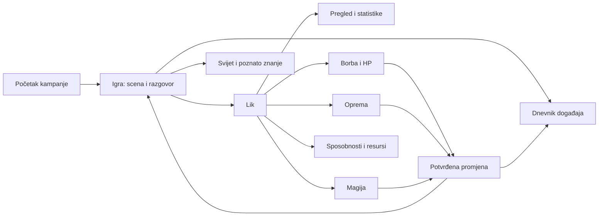
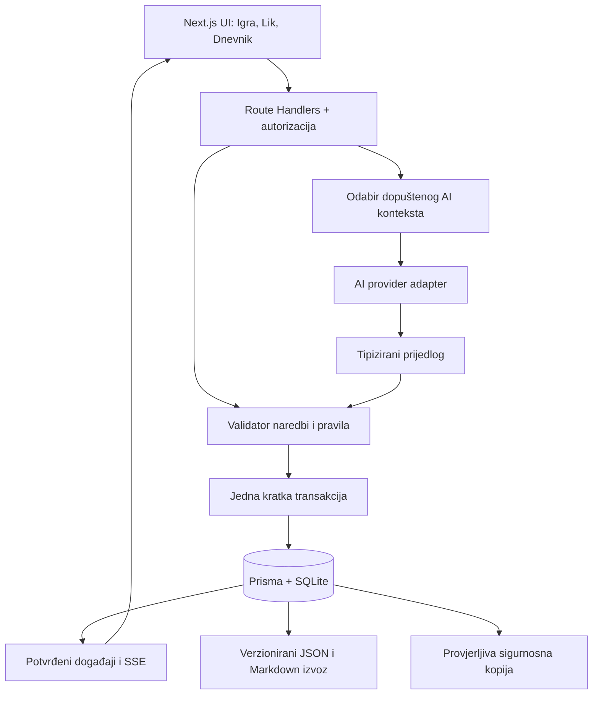
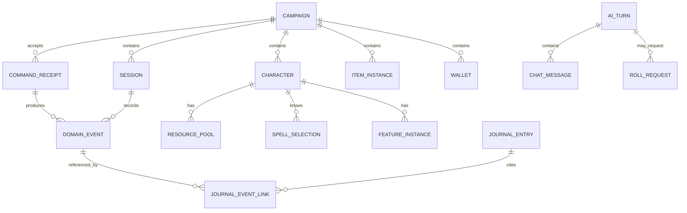
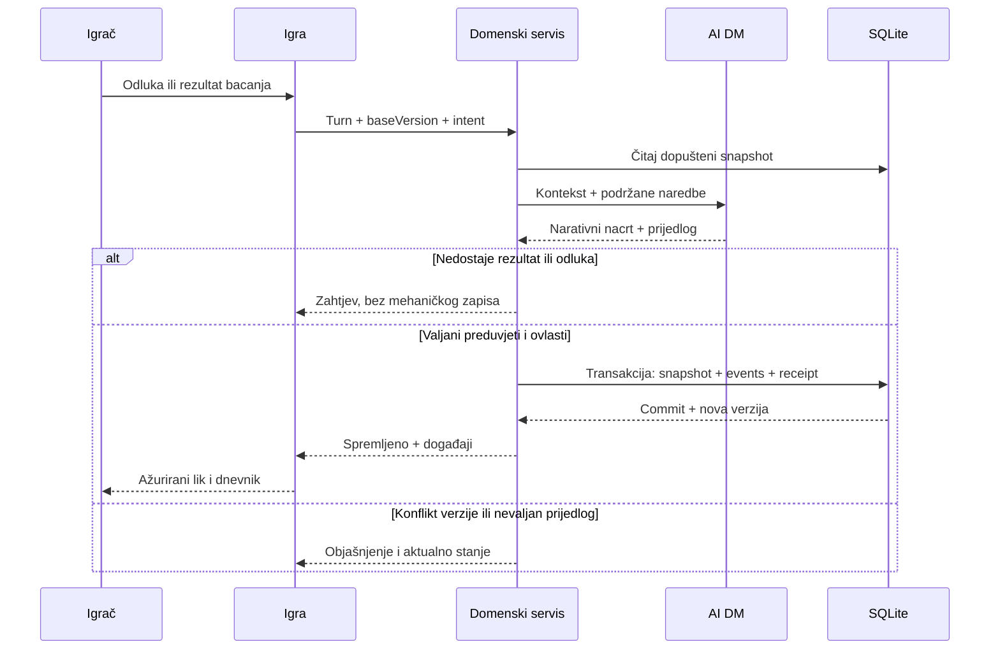

# Kronike Devet Zvona — specifikacija Campaign Companiona

Datum: 24. studenoga 2026. Status: prijedlog za razvoj; aplikacija nije implementirana. Polazni lokalni pregled obavljen je 23. studenoga.

Ovaj dokument opisuje originalan proizvod. Ni arhitektura, ni model podataka, ni predložene interakcije nisu tvrdnje o internoj implementaciji D&D Beyonda. Nalazi o referentnoj aplikaciji pripadaju zasebnoj analizi.

## 1. Namjena i granice

Companion treba omogućiti solo igranje kampanje na hrvatskom jeziku: pregled lika, brzo upravljanje borbenim stanjem, razgovor s AI Dungeon Masterom i pouzdan dnevnik posljedica. Svijet i sadržaj kampanje ostaju originalni Nareth. Igrač donosi odluke svojeg lika; DM upravlja svijetom i posljedicama. Rezultate bacanja zadano unosi igrač. Napredovanje je milestone.

MVP uključuje jednu lokalnu kampanju, jednog igrača, digitalni character sheet, inventory, spells, features/resources, journal, razgovor s AI DM-om, potvrđene promjene stanja i izvoz. Ne uključuje marketplace pravila, D&D Beyond sinkronizaciju, scraping character API-ja, reprodukciju tuđeg dizajna, virtualni stol, automatski uvoz kupljenih knjiga ni potpuno automatiziran simulator svih 5e pravila.

Pravila moraju imati eksplicitni profil `dnd5e-2024` i verziju. Nepodržana pravila ostaju predmet obrazložene DM odluke i evidentirane ručne korekcije. Sadržaji dobivaju polja podrijetla i dopuštenja; u proizvod ulaze originalni sadržaj, sadržaj korisnika i provjereno dopušteni izvori. D&D Beyond slike, CSS, fontovi, kod i vlasnički opisi ne ulaze u projekt.

## 2. Obveze prema postojećem projektu

Pročitani izvori: `README_START.md`, `prompts/PROJECT_INSTRUCTIONS.md`, `state/character.json`, `state/current-state.json`, `scripts/Test-Kampanja.ps1` te struktura `events/`, `sessions/` i `handoff/`. Sadržaj `dm_private/` nije pregledavan za ovu specifikaciju.

Postojeće pravilo „Bez potvrđenog upisa nema potvrđenog spremanja” postaje glavni UI i podatkovni invariant. Naracija, AI prijedlog i lokalni prikaz na klijentu nisu dokaz upisa. Oznaku „Spremljeno, verzija N” smije dati samo odgovor nakon uspješne transakcije.

Pri pregledu lokalnih datoteka zatečeno je: kampanja `KDZ-001`, lik `PC-001`, `stateVersion: 2`, `lastEventId: KDZ-S001-E013`. To su ulazne činjenice za budući migracijski test, ne nalog za promjenu kampanje. Import mora ponovo očitati aktualno stanje u trenutku izvršavanja.

Posebno treba očuvati:

- Razliku između trenutačnih strukturiranih polja i povijesnog Markdown opisa. Stariji narativni odlomak ne smije vratiti potrošen resurs.
- `heroicInspiration: null` znači nepoznato, a ne „nema inspiracije”.
- Zabilježeni potrošeni resursi ostaju potrošeni: spell slots 0/2 i besplatna uporaba Divine Smitea 0/1. Novi dan ili nova sesija nisu odmor.
- Osobnih 21 GP i namjenskih grupnih 5 GP pripadaju različitim računima; zbroj nije osobni novac lika.
- Predmet može imati vlasnika, trenutačnog držatelja i lokaciju; nepoznato držanje ne znači vlasništvo igrača.
- Glasina, opažanje, NPC tvrdnja, zaključak i objektivni kanon nisu ista vrsta znanja.

## 3. Navigacija i originalni UX

Glavne cjeline su **Igra**, **Lik**, **Dnevnik** i **Svijet**. Postavke, sigurnosne kopije i pravila dostupni su odvojeno. Otvaranje igre vraća posljednju potvrđenu scenu, verziju i otvorena pitanja, a ne izmišljeni nastavak.

Na desktopu je Igra podijeljena na naraciju s unosom odluke, sažetak lika i posljednje potvrđene promjene. Lik ima kartice Pregled, Borba, Oprema, Magija, Sposobnosti i Bilješke. Umjesto dekorativnog papirnatog lista koristi se mirna tipografija, izvorne jednostavne ikone i jasne numeričke skupine. Boja pomaže orijentaciji, ali tekst i znakovi prenose svako stanje.

Na mobitelu su Igra, Lik, Dnevnik i Više u donjoj navigaciji. HP i koncentracija ostaju u kompaktnom zaglavlju prikaza lika. Dugački popisi postaju kartice ili listovi detalja. Otvaranje detalja čuva položaj skrola, a povratak vraća fokus na izvorni element. Odabir cilja ili resursa mora biti vidljiv prije potvrde. Nijedna radnja ne ovisi o hoveru ili samo o drag-and-drop gesti.

Ciljevi provjere: širine 360, 390, 768 i 1440 CSS px; bez horizontalnog skrola osnovnih tokova; dodirna područja ciljano najmanje 44 × 44 px; rad tipkovnicom; vidljiv fokus; čitljiv prikaz pri 200% zoomu; pristupačne oznake polja; status upisa preko nenametljivog live regiona. To su kriteriji našeg proizvoda, ne opažanja o D&D Beyondu.

## 4. Funkcionalni ugovori

| Područje | Prikaz i uređivanje | Ugovor stanja |
|---|---|---|
| Statistike | Šest ability scores, modifikatori, saves, skills, AC, inicijativa, brzina, proficiency. Detalj prikazuje izvore bonusa. | Odvojiti osnovnu vrijednost, izvedenu vrijednost i obrazloženi override. Promjena atributa preračunava samo pravila podržana odabranim profilom. |
| HP | Current/max/temp, unos iznosa i odvojene radnje Šteta, Liječenje, Temp HP. Prije slanja kratak pregled posljedice. | Cijeli brojevi, granice, tip štete i primijenjeni modifikatori. Temp HP i current HP nisu isti pool. Primjena štete i zapis događaja jedna su transakcija. |
| Borba | Akcije, bonus akcije, reakcije, ostalo; pretraživanje, cilj, domet i trošak. Inicijativa i red poteza osnovni su kontekst. | „Odaberi akciju” još nije „izvršeno”. Napad vodi do zahtjeva za bacanje; ne proglašava pogodak niti troši dodatni resurs bez razriješenog pravila. |
| Inventory | Naziv, količina, vlasnik, držatelj, spremnik, equipped/attuned, masa ako je poznata; odvojeni novčani računi. | Količina ne smije postati negativna. Prijenos oduzima i dodaje u istom batchu. Spremnici ne smiju stvoriti ciklus. Nepoznate mase nisu 0. |
| Spells | Known/prepared/always-prepared, razina, slotovi, koncentracija i povezan izvor sadržaja. | Poznavanje, priprema i cast različite su operacije. Cast odabire način troška; besplatna uporaba i slot nisu automatski dvostruko terećenje. |
| Features/traits | Pasivne osobine, aktivne sposobnosti, uvjeti uporabe, povezani resursi i dopuštena bilješka. | Pasivna osobina nije potrošni counter. Aktivna sposobnost referencira konkretan pool, recharge pravilo i verziju pravila. |
| Resursi i odmor | Current/max ili nepoznato; pregled što će kratki/dugi odmor promijeniti. | Samo potvrđen odmor obnavlja resurse prema podržanim pravilima. Nova sesija ili jutro nisu dovoljan okidač. Potrošnja hit dice odvojena je od rezultata liječenja. |
| Conditions | Naziv, izvor, trajanje, početak i uvjet isteka; koncentracija odvojeno. | Kraj koncentracije uklanja samo efekte koji su njome povezani. Primljena šteta može otvoriti zahtjev za concentration save; ne izmišlja rezultat. |
| Journal | Kronologija s filtrima po sesiji, liku, lokaciji, NPC-u, zadatku i vrsti znanja. | Potvrđeni događaji čine zapis; AI sažetak je verzionirana izvedenica s izvorima. Osobne bilješke ne mijenjaju mehaniku. |

Napredni učinci poput death saves, masivne štete, višeklasnih spell slotova ili složenih reakcija zahtijevaju eksplicitno podržano pravilo i test prije automatske primjene. U suprotnom se prikazuju kao neriješen zahtjev za DM odluku. UI ne smije šutke zaokružiti, odrezati vrijednost ili pretpostaviti uspjeh.

Svaka mutacija prikazuje prijelaz: **Nacrt → Provjera → Spremanje → Spremljeno**, ili **Konflikt / Odbijeno / Veza prekinuta**. Odgovor nakon timeouta nije dokaz neuspjeha: klijent provjerava isti command ID. „Poništi” stvara kompenzacijski događaj nakon provjere kasnijih ovisnosti; ne briše povijest.

## 5. Arhitektura

Predloženi sustav je Next.js App Router aplikacija u jednom trajnom Node.js procesu, Prisma kao podatkovni sloj i SQLite na lokalnom trajnom disku. Server Components služe početnom čitanju; Client Components obuhvaćaju interaktivne kontrole i stanje obrasca. To slijedi službenu podjelu Next.js odgovornosti. [Next.js: Server and Client Components](https://nextjs.org/docs/app/getting-started/server-and-client-components)

Route Handlers pružaju HTTP ugovore za naredbe, čitanje događaja i AI tok. Svi zapisi prolaze isti domenski servis, bez obzira dolaze li iz ručnog uređivanja ili AI prijedloga. Klijent nikad ne pristupa bazi izravno. [Next.js: Route Handlers](https://nextjs.org/docs/app/getting-started/route-handlers)

Prisma podržava lokalni SQLite. Točnu generaciju Prisma API-ja, adapter i kompatibilan Node.js treba zaključati u prvoj razvojnoj fazi. Aktualna dokumentacija i verzionirana v7 dokumentacija imaju različite API oblike; ovaj plan namjerno definira podatkovne ugovore bez miješanja primjera tih generacija. [Prisma: SQLite v7](https://www.prisma.io/docs/orm/v7/core-concepts/supported-databases/sqlite), [Prisma: Transactions](https://www.prisma.io/docs/orm/fundamentals/transactions)

SQLite odgovara početnom solo proizvodu. WAL može omogućiti čitanje uz pisanje, ali postoji samo jedan pisac; WAL nije rješenje za više poslužitelja nad mrežnim direktorijem. Koristiti kratke transakcije, ograničene ponovne pokušaje na zauzetu bazu i trajni lokalni volumen. AI poziv nikada ne ostaje unutar otvorene DB transakcije. [SQLite: Isolation](https://www.sqlite.org/isolation.html), [SQLite: WAL](https://www.sqlite.org/wal.html)

Početni deployment je lokalni Node.js ili jedan privatni poslužitelj s trajnim volumenom. Ephemeral serverless filesystem nije mjesto za primarnu SQLite datoteku. Mobilni pristup znači pristup istom poslužitelju, ne stvaranje druge autoritativne baze. Ako se kasnije traži više instanci ili više aktivnih kampanja s velikim brojem pisanja, migraciju baze planirati zasebno. Next.js podržava self-hosting i streaming, uz provjeru da proxy ne bufferira tok. [Next.js: Self-hosting](https://nextjs.org/docs/app/guides/self-hosting)

## 6. Konceptualni model podataka

Ovo je model za buduću Prisma shemu; nije izvršiva migracija.

| Entitet | Glavna polja i ograničenja |
|---|---|
| Campaign | `id`, `name`, `rulesetId`, `rulesetVersion`, `stateVersion`, `lastEventSeq`, `lastLegacyEventId`, lokacija i vrijeme; nepoznata kalendarska polja nullable. |
| Member | `campaignId`, `actorId`, `role`; unique par; početno jedan owner/player. AI service actor ima uži scope od vlasnika. |
| Character | Stabilni `id`, `campaignId`, profil, razina, ability scores, current/max/temp HP, status; strukturirani izvori i overrideovi izvedenih vrijednosti. |
| StatModifier | `characterId`, ciljno polje, izvor, vrijednost, uvjet, rule version, razlog i opcionalni istek. |
| ResourcePool | `id`, `characterId`, vrsta, `current`, `max`, `known`, recharge politika; unique `(characterId, resourceKey)`. |
| FeatureInstance | `characterId`, `definitionRef`, verzija, izvor, optional resourcePoolId, osobna bilješka. |
| SpellSelection | `characterId`, `definitionRef`, known/prepared/alwaysPrepared, izvor; zasebno od ResourcePool za spell slotove. |
| ActiveEffect | cilj, izvor događaja, tip, trajanje, concentrationGroupId, status; bez pretpostavljenog isteka. |
| ItemInstance | `id`, kampanja, naziv, quantity, ownerId, holderId, location, containerId, equipped/attuned, nullable masa; reference pripadaju istoj kampanji. |
| Wallet | `id`, vlasnik ili skupina, svrha, integer najmanjih jedinica, naziv valute; osobni i namjenski novac odvojeni. |
| Session | `id`, broj, početna/završna verzija, status, stvarno vrijeme i odvojeno vrijeme svijeta. |
| CommandReceipt | `(campaignId, commandId)` unique, hash kanonskog payload-a, actor, outcome, verzija prije/poslije i rezultat za ponavljanje odgovora. |
| DomainEvent | `id`, `(campaignId, seq)` unique, sessionId, commandId, type, schemaVersion, payload, actor, sourceRef, occurredAt, worldTime, visibility, knowledgeKind. |
| JournalEntry | veze na događaje, naslov, tekst, vrsta manual/projection/summary, revision, visibility; sažetak ima točne sourceEventIds. |
| ChatMessage | turnId, role, tekst, status, visibility, stateVersionUsed; nedovršeni odgovor ostaje označen. |
| AiTurn | `id`, kampanja, baseVersion, status, context manifest, prijedlog, povezani receipt; lease za siguran oporavak nakon restarta. |
| RollRequest / RollResult | vrsta bacanja, razlog, formula, status; rezultat i podrijetlo manual/system, vezani turn i događaj. |
| EntityRecord / KnowledgeAssertion | NPC, quest, location, odnos ili tvrdnja; stabilni ID, visibility, epistemicType, izvor, subjekt i status. |
| ImportBatch / ExportJob | izvorni hash, schemaVersion, mapiranje legacy ID-jeva, manifest, status, verzija, pogreške i datum provjere. |

Svi entiteti koji imaju kampanju validiraju pripadnost kampanji. JSON payload događaja ima verzioniranu tipiziranu shemu; JSON nije dopuštenje za proizvoljne update putanje. DB migracije trebaju provoditi strane ključeve, unique ograničenja i dostupne CHECK uvjete, uz ponovljenu provjeru u domenskom sloju. Datumi upisa spremaju se u UTC-u, prikazuju u Europe/Warsaw; vrijeme Naretha zasebno je podatkovno područje.

## 7. Naredbe, transakcije i sinkronizacija

Minimalni envelope naredbe sadrži `schemaVersion`, `commandId`, `campaignId`, `expectedStateVersion`, `intentRef` i tipizirani payload. Identitet i ovlasti actor-a određuje server iz autentificiranog konteksta; ne vjeruje `actorId` polju iz AI izlaza. `intentRef` povezuje radnju s igračevim odabirom, potvrđenim bacanjem ili dopuštenom DM posljedicom.

Početni skup naredbi: `ApplyDamage`, `ApplyHealing`, `SetTemporaryHp`, `ConsumeResource`, `ResolveCast`, `TransferItem`, `SpendCurrency`, `ApplyCondition`, `EndConcentration`, `RecordRoll`, `CompleteRest`, `AppendJournalNote`, `RecordWorldFact`, `CorrectConfirmedFact`. Složena radnja šalje jedan batch, npr. lijek + potrošnja predmeta + HP + journal događaj. Naredbe koriste stabilne ID-jeve, nikada slobodan naziv kao jedini identifikator.

Obrada je strogo određena:

1. Provjeriti identitet, scope kampanje, veličinu, tip i verziju payload-a.
2. Ako receipt za `commandId` već postoji, usporediti hash. Isti payload vraća isti rezultat; različit payload uz isti ID vraća konflikt.
3. U kratkoj transakciji usporediti očekivanu verziju s aktualnom, provjeriti preduvjete te izračunati cjelokupan novi snapshot.
4. Atomski upisati snapshot, sve događaje, minimalnu journal projekciju, receipt i povećanje `stateVersion` jednom po batchu. Event sequence raste po događaju.
5. Tek nakon commita poslati potvrdu klijentu. Izvoz i bogati AI sažetak mogu kasniti, ali osnovni journal događaj ne smije nestati.

Unique ključ i provjera verzije ostaju unutar iste transakcijske granice. Dva različita command ID-ja s istom početnom verzijom ne mogu oba promijeniti stanje kao da su prva. Konflikt zastarjele verzije vraća HTTP 409 i aktualnu verziju, bez tihog ponavljanja štete ili troška. Automatski retry dopušten je za privremenu DB zauzetost prije konačnog ishoda, s istim command ID-jem. Poslije promjene sadržaja ili rebase-a potreban je novi ID. Transakcije i kontrola konkurentnosti podržani su koncepti Prisma sloja; točan API mora odgovarati zaključanoj verziji. [Prisma: Transactions](https://www.prisma.io/docs/orm/fundamentals/transactions), [Prisma v7: Optimistic concurrency control](https://docs.prisma.io/docs/orm/v7/prisma-client/queries/transactions)

Predloženi HTTP ugovori:

| Endpoint | Rezultat |
|---|---|
| `GET /api/campaigns/:id/snapshot` | Dopušteni snapshot, stateVersion i posljednji vidljivi cursor; bez DM tajni. |
| `POST /api/campaigns/:id/commands` | Receipt potvrđenog batcha; 409 konflikt, 422 nepodržan/neispravan prijedlog, 403 bez ovlasti. |
| `GET /api/campaigns/:id/commands/:commandId` | Oporavak ishoda nakon timeouta. |
| `GET /api/campaigns/:id/events?after=cursor` | Paginirani dopušteni događaji za replay. |
| `GET /api/campaigns/:id/stream` | SSE obavijesti s cursorom; reconnect koristi trajni event log. |
| `POST /api/campaigns/:id/turns` | Novi AI turn s ID-jem, početnom verzijom i igračevim intentom. |
| `POST /api/campaigns/:id/rolls/:rollId/result` | Rezultat igračeva bacanja s provjerom pending zahtjeva. |
| `POST /api/campaigns/:id/exports` | Job i rezultat provjerenog JSON/Markdown izvoza. |

SSE je dostava, ne izvor istine. Klijent ignorira već obrađene događaje, nakon praznine dohvaća replay/snapshot, a nakon povratka iz pozadine provjerava verziju. Ako SSE nije dostupan, periodično čitanje verzije je prihvatljiv fallback. Brojač koji je samo optimistično promijenjen prikazuje pending status. Offline MVP dopušta pregled posljednjeg stanja i nacrt teksta, ali ne potvrđuje mehaničke zapise bez servera.

## 8. AI Dungeon Master i automatska ažuriranja

AI dobiva verzionirani snapshot, relevantne dopuštene događaje, pravila kampanje, otvorena pitanja i katalog podržanih naredbi. Ne dobiva SQLite pristup, proizvoljan SQL, filesystem write alat ili ovlast mijenjanja proizvoljnih JSON putanja. Tekst korisnika, pisma u svijetu i uvezeni dokumenti tretiraju se kao sadržaj, a ne kao instrukcije za proširenje ovlasti.

AI izlaz ima tri odvojena dijela: narativni nacrt, strukturirane predložene posljedice i neriješene zahtjeve. Automatski se primjenjuju samo posljedice koje imaju valjan izvor, podržano pravilo, točnu verziju stanja i dopušten scope. „Igrač napada”, „troši zadnji slot”, „prihvaća zadatak” ili „odmara” moraju potjecati iz igračevog stvarnog odabira, ne AI improvizacije. Prijedlog s dvojbenim ciljem, nepoznatim rezultatom bacanja, novim pravilom ili promjenom potvrđene prošlosti čeka odluku.

| Situacija | Ponašanje |
|---|---|
| Igrač odabere potrošnju poznatog resursa | Validator provjerava uvjete; trošak, učinak i journal upisuju se automatski jednim batchom. |
| DM razriješi dopuštenu posljedicu s potvrđenim bacanjem | Primjena slijedi provjereni postupak odabranog skupa pravila i referencira bacanje; nema dodatne generičke potvrde za svaki HP. |
| Nedostaje roll ili pravilo | Turn prelazi u `awaiting_roll` ili `needs_ruling`; mehaničko stanje ostaje nepromijenjeno. |
| AI predlaže odluku umjesto igrača | Prijedlog se vraća kao opcija; ne postaje događaj. |
| AI želi ispraviti kanon | Prikazuje izvor i prije/poslije; zahtijeva igračev eksplicitni izbor i stvara korekcijski događaj. |
| Provider prekine odgovor | Nacrt ostaje nepotpun; nepotpuni JSON se ne izvršava; već potvrđen command ne ponavlja se. |
| Igrač ručno izmijeni HP tijekom AI odgovora | AI batch postaje zastario; ponovno se procjenjuje prema novom snapshotu. |

Automatski ne znači nekontrolirano, nego da se potvrđena i razriješena radnja odmah odrazi u liku i dnevniku bez ručnog prepisivanja. UI uz promjenu pokazuje „što”, „zašto”, „iz kojeg poteza” i „koja verzija”.

Narativ koji tvrdi da je učinak konačan smije biti objavljen kao potvrđen tek nakon commita. Dopušten je raniji streaming atmosferskog teksta uz oznaku nacrta, ali ne i konačna tvrdnja „HP je spremljen”. Završni tekst temelji se na receipt-u. Ako poziv koji oblikuje tekst zakaže nakon commita, mehanička promjena ostaje potvrđena i vidljiva; UI pokazuje sažetak događaja bez ponovnog izvršavanja radnje.

Postojeći način igranja u vanjskom ChatGPT chatu ne podrazumijeva automatski pristup ovom projektu. MVP integracija je razgovor unutar Companiona s odabranim AI providerom. Za nastavak u vanjskom chatu ostaju verzionirani handoff i eksplicitni uvoz. Budući konektor/alati zahtijevaju zaseban autentificirani ugovor; ne koriste se session tokeni D&D Beyonda niti drugog sučelja.

## 9. Dnevnik, znanje i privatnost

Dnevnik ima tri sloja: nepromjenjive potvrđene domenske događaje, uređive osobne bilješke i izvedene narativne sažetke. Sažetak mora navesti događaje od kojih je nastao, raspon verzija i vrijeme izrade. Revizija sažetka ne mijenja događaje. Ručna ispravka prošlosti dodaje novi događaj koji referencira izvorni.

Svaka tvrdnja ima `knowledgeKind` poput `observed`, `reported`, `rumor`, `inferred`, `canon`, te visibility `player`, `dm` ili `shared`. Vidljivost se provjerava na serveru za snapshot, SSE, journal, pretragu, export, RSC payload i AI kontekst. Skrivanje CSS-om nije zaštita. DM sadržaj ne smije završiti u client bundleu, poruci greške ili zajedničkom cacheu.

Ako DM model dobiva privatne činjenice, njegov sirovi izlaz ne smije se izravno slati igraču. Potreban je odvojen strukturirani izbor dopuštenih otkrića i player-facing naracija koja dobiva samo odobreni kontekst. U MVP-u je sigurnija granica da javni narator uopće ne dobiva tajne. Vlasnik solo kampanje može upravljati DM sadržajem u zasebnom prikazu, ali player prikaz mora ostati filtriran.

Početni lokalni servis veže se na loopback. Za pristup mobitelom preko mreže uvode se autentifikacija, ograničene sesije, origin/CSRF provjera i TLS kroz odabrani deployment. AI ključevi ostaju server-side, izvan eksportiranih kampanja i logova. Logovi bilježe ID-jeve i tehnički status, ne tajne i pune promptove po zadanim postavkama.

## 10. Migracija i trajno spremanje

Danas su lokalne datoteke autoritet. Ova dokumentacija to ne mijenja. Buduća migracija mora najprije izraditi snapshot izvora i manifest hashova, validirati JSON/JSONL i veze, zatim prikazati razlike i neriješene stavke. Postojeći `Test-Kampanja.ps1` provjerava parsiranje, ali ne potvrđuje sve domenske invarijante niti konzistentnost Markdown duplikata.

Nakon prihvaćenog i provjerenog uvoza, SQLite datoteka postaje novi lokalni autoritativni zapis. JSON, JSONL, sessions Markdown i handoff generiraju se kao verzionirane projekcije. Ne provodi se nekontrolirani dual-write baze i starih datoteka. Izmjene izvan aplikacije ulaze kroz novi import s očekivanom verzijom i usporedbom; ne prepisuju tiho bazu.

| Postojeći izvor | Buduće mapiranje |
|---|---|
| `state/current-state.json` | Campaign snapshot, lokacija/vrijeme, referenca sesije i verzija; očuvani legacy ID-jevi. |
| `state/character.json` | Character, ResourcePool, ItemInstance, SpellSelection, FeatureInstance, Wallet i zasebne bilješke. |
| `events/events.jsonl` | Legacy događaji s izvornim payloadom/hashom i stabilnim ID-jevima. Nema izmišljanja nedostajućih mehaničkih detalja. |
| `sessions/*.md` | Izvorni session dokumenti kao prilozi te buduća generirana sažeta projekcija. |
| `npcs/`, `quests/`, `world/` | Stabilni registri i tvrdnje s izvorom, vrstom znanja i vidljivošću. |
| `handoff/ZA_CHAT.md` | Generirani handoff s verzijom stanja i zadnjim događajem. |
| `dm_private/` | Zaseban eksplicitni import s DM klasifikacijom; nikada automatski dio player exporta. |

Povijesni narativni događaji možda nisu dovoljni za replay trenutačnog stanja. Zato uvoz čuva verificirani početni snapshot i legacy povijest; deterministički replay jamči se od novog snapshot baseline-a nadalje. Nepoznate vrijednosti ostaju nepoznate. Konflikt između strukturiranih polja i teksta prikazuje se u migracijskom izvještaju; nije dopušteno proizvoljno popunjavanje.

Export stvara novu generaciju direktorija s manifestom, `stateVersion`, event cursorom i hashovima. Nakon uspješnog pisanja i ponovnog čitanja objavljuje se pointer na cijelu generaciju. Zastoj exporta ne poništava DB commit; prikazuje se „Spremljeno u bazu; izvoz čeka”. Povratak u stari datotečni režim zahtijeva zaustavljanje pisanja, potpuni provjereni export i eksplicitni cutover.

Sigurnosne kopije izrađuju se SQLite backup mehanizmom ili provjerenim snapshot postupkom koji obuhvaća konzistentno stanje. Kopiranje samo aktivne `.db` datoteke uz ignoriranje WAL-a nije valjan plan. Restore test treba potvrditi integritet, verziju i posljednji događaj u zasebnom direktoriju prije zamjene aktivne baze. [SQLite: Online Backup API](https://www.sqlite.org/backup.html)

## 11. Mjerila prihvata

MVP je spreman za stvarno igranje tek kada prolaze sljedeći slučajevi:

1. Potvrđena šteta/liječenje, resurs i journal promijene se zajedno ili se ništa ne promijeni.
2. Dvostruki klik i ponovljeni HTTP zahtjev ne udvostručuju učinak; isti ID s drugim payloadom je odbijen.
3. Paralelna ručna i AI izmjena s istom početnom verzijom uzrokuju jedan commit i jedan jasan konflikt.
4. Prekid nakon commita i prije odgovora razriješi se receipt upitom bez ponavljanja troška.
5. AI ne može proizvoljno izvršiti SQL, izmijeniti drugu kampanju, izmisliti bacanje ili donijeti igračevu odluku.
6. Obnova stranice i SSE reconnect prikazuju točno posljednje potvrđeno stanje.
7. Nepoznati resursi, vlasništvo i vrijeme ostaju nepoznati kroz import, uređivanje i export.
8. DM tajne nisu prisutne u player HTTP odgovorima, RSC payloadu, SSE-u, pretrazi ni exportu.
9. Restore kopije obnavlja istu verziju i stanje; replay od baseline-a daje isti snapshot.
10. Osnovni tokovi na mobitelu i tipkovnici dostupni su bez hovera i bez gubitka nacrta.

Plan izvođenja i testiranja nalazi se u [03-razvojni-plan.md](03-razvojni-plan.md).
